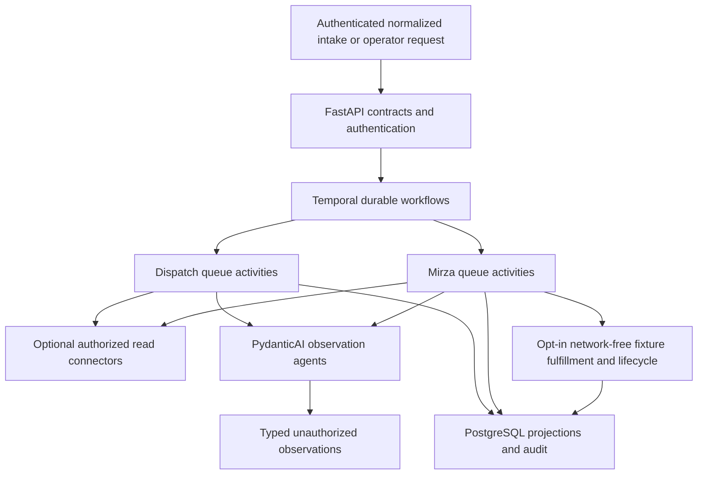

# Architecture Overview

Repository baseline dated 2026-10-28, maintained by the developer agent and shared
with diagnosis. Sources are the current checkout and linked historical docs; no
fresh node observation, runtime check or inference was performed for this baseline.

## Request flow

The service covers Helpdesk group correction and the eight approved Mirza jobs.
The [plan](../../plan.md) and [decision register](../../docs/step-1-decisions.md)
define scope; implemented observation and synthetic execution do not enable live
fulfillment. [Root authority](../../AGENTS.md) continues to govern.

This map groups distinct paths; it does not imply all requests invoke inference
or fixtures. The context endpoint reads directly through connectors without
enrolling a workflow. The optional listener polls through Temporal activities.
Temporal owns waiting, signals, replay and lifecycle timers; projections do not
independently resume execution. External I/O, inference and database effects belong
in activities, outside deterministic workflow bodies.

## Code and boundaries

| Path | Responsibility |
|---|---|
| [app/api](../../app/api/) | FastAPI, intake/operator authentication, normalized contracts, context/review/operation endpoints and health |
| [app/contracts](../../app/contracts/) | Typed ticket, observation, approval, provisioning and lifecycle boundaries |
| [app/workflows](../../app/workflows/) | Temporal deterministic orchestration; preserve original Step 8 type for replay alongside Step 9 lifecycle type |
| [app/activities](../../app/activities/) | I/O, durable receipts, policy invocation and projection updates |
| [app/worker.py](../../app/worker.py) | Separate dispatch/Mirza registrations, task queues and heartbeats |
| [app/agents/observation.py](../../app/agents/observation.py) | PydanticAI classification/extraction with bounded read tools; no authorization or privileged writes |
| [app/connectors](../../app/connectors/) | Optional ServiceDesk/directory/Mirza/Mattermost reads, process indexes and isolated synthetic fulfillment connector |
| [app/policies](../../app/policies/) | Deterministic scope, approval, assignment, ownership, expiry and recovery checks outside agents |
| [app/storage](../../app/storage/) and [migrations](../../migrations/) | Application PostgreSQL projections/audit, observations/reviews and isolated fixture state; Alembic schema |
| [app/settings.py](../../app/settings.py) and [compose.yaml](../../compose.yaml) | Observation defaults, disabled inference/polling, process settings and local runtime |
| [pyproject.toml](../../pyproject.toml), [tests/unit](../../tests/unit/) and [scripts](../../scripts/) | Python package `app`, pytest discovery and explicit verification/probe tools |

PydanticAI inference permits only `local-qwen3.8`; typed outputs remain
`authorized: false`. Observation completeness does not verify approval, ordering
or current approved terms. No native ServiceDesk, Mirza or Mattermost writer is
enabled. The simulator's generated identities and private cipher/owner-delivery
boundary cannot serve as native execution authority.

## State and runtime evidence

[Runtime operations](../../docs/runtime-operations.md) describes the local Compose
stack, separate application/Temporal databases, migration and heartbeat checks.
Its commands can mutate local state and require applicable scope. The runtime
surface in [app/api/main.py](../../app/api/main.py) reports empty external write
capabilities in this checkout; this is source evidence, not a current endpoint
observation. No current deployed revision, live topology, health or permission
scope is established here. Historical aliases are limited to evidence described
in [cross-file facts](cross-file-facts.md), not assumed connection permission.

Read [cross-file facts](cross-file-facts.md) before changes. Maintain consequential
choices through the [decision index](../decisions/README.md), every development
task through [DEV records](../records/developer-changelog.md), and investigations
through the [incident ledger](../diagnostic-agent.md#incident-ledger).
